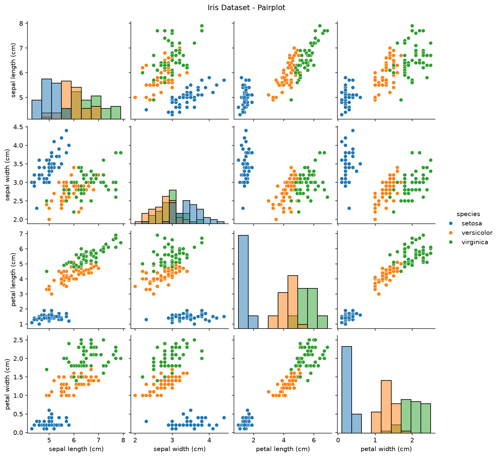
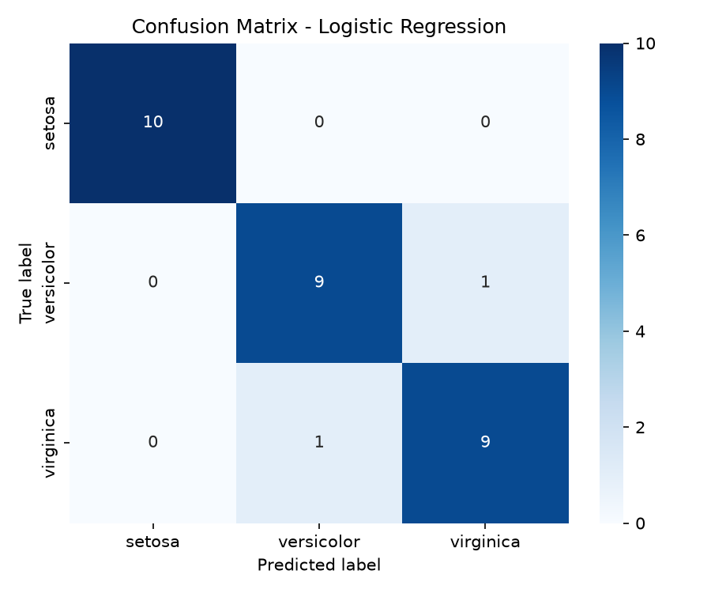
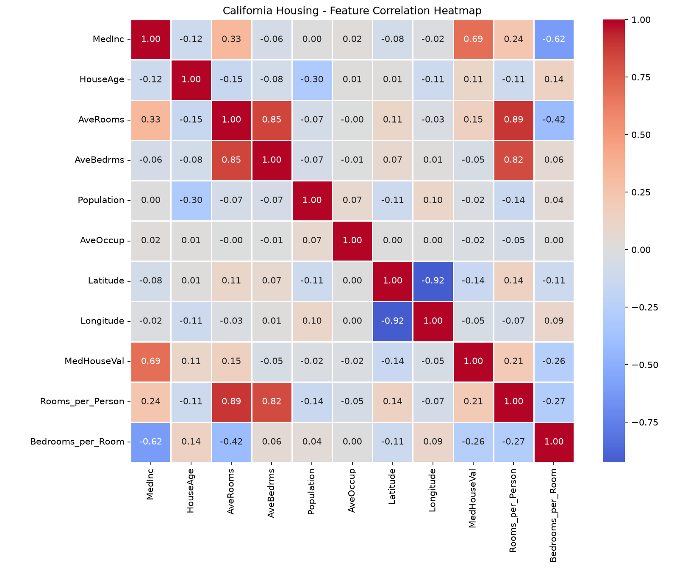
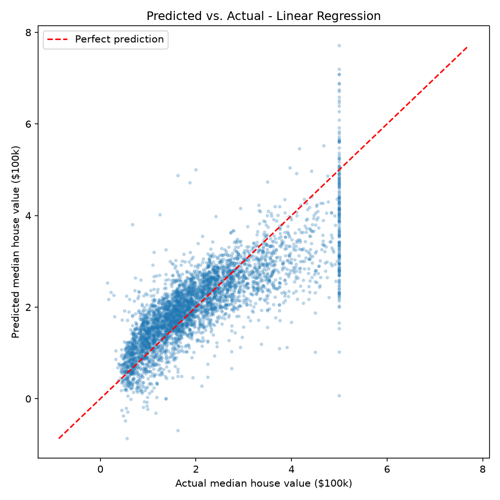
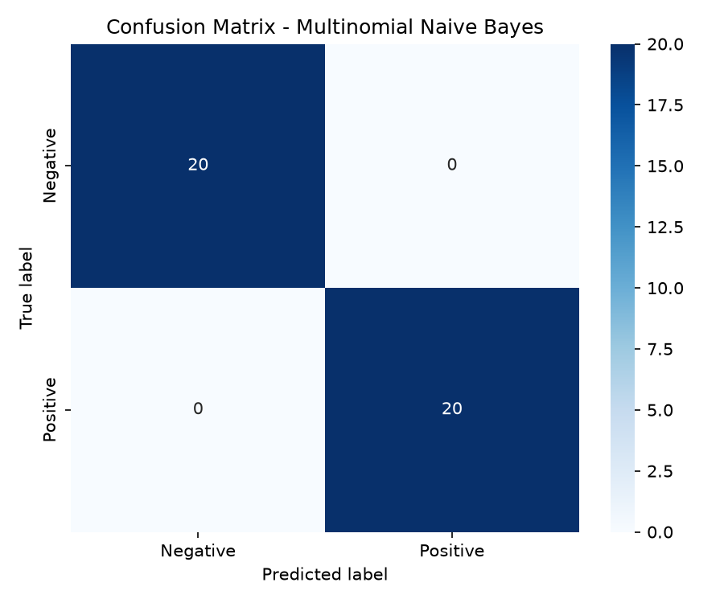

# README.md
# Datheon ML Internship

Machine Learning & Data Science internship projects for **Datheon**, covering
classification, regression, and NLP. Every script loads its data automatically
(scikit-learn built-ins or an in-script synthetic dataset) and saves its charts
as `.png` files next to the script.

| Task | Topic | Dataset |
|------|-------|---------|
| 1 | Multi-class classification | Iris (`sklearn.datasets`) |
| 2 | Regression with Ridge/Lasso tuning | California Housing (`sklearn.datasets`) |
| 4 | TF-IDF sentiment classification | Synthetic 200-review dataset |

## Installation

Requires Python 3.9+.

```bash
git clone https://github.com/<your-username>/datheon-ml-internship.git
cd datheon-ml-internship
python -m venv .venv
source .venv/bin/activate        # Windows: .venv\Scripts\activate
pip install -r requirements.txt
```

## Running the scripts

```bash
python Task1_Iris_Classification/task1_classification.py
python Task2_Housing_Regression/task2_regression.py
python Task4_NLP_Sentiment/task4_nlp_sentiment.py
```

Note: Task 2 downloads the California Housing dataset on first run (needs
internet; cached afterwards). Task 4 downloads the NLTK stopwords list and falls
back to scikit-learn's stopword list if that is not possible.

## Outputs

| Task | Generated files |
|------|-----------------|
| 1 | `pairplot.png`, `confusion_matrix_logistic_regression.png`, `confusion_matrix_decision_tree.png` |
| 2 | `correlation_heatmap.png`, `predicted_vs_actual.png`, `residuals.png` |
| 4 | `nlp_confusion_matrix.png` |

## Results summary

**Task 1 - Iris:** Logistic Regression and a Decision Tree are trained on a
stratified 80/20 split with standardized features, and compared by test
accuracy, with per-class precision, recall and F1.

**Task 2 - California Housing:** Two engineered features (`Rooms_per_Person`,
`Bedrooms_per_Room`) are added. Linear Regression, Ridge and Lasso are compared
on RMSE, MAE and R², with alpha tuned by 5-fold GridSearchCV. The best model by
RMSE is used for the predicted-vs-actual and residual plots.

**Task 4 - NLP Sentiment:** Reviews are lowercased, stripped of punctuation and
stopwords, and vectorized with TF-IDF. Multinomial Naive Bayes and Logistic
Regression are compared on accuracy and F1. The dataset is synthetic and built
from repeated phrase templates, so scores will be very high and should not be
read as real-world performance.

### Visualizations

**Task 1 - Iris Classification:**



**Task 2 - California Housing:**



**Task 4 - NLP Sentiment:**


## Project structure

```
datheon-ml-internship/
├── requirements.txt
├── README.md
├── .gitignore
├── Task1_Iris_Classification/task1_classification.py
├── Task2_Housing_Regression/task2_regression.py
└── Task4_NLP_Sentiment/task4_nlp_sentiment.py
```